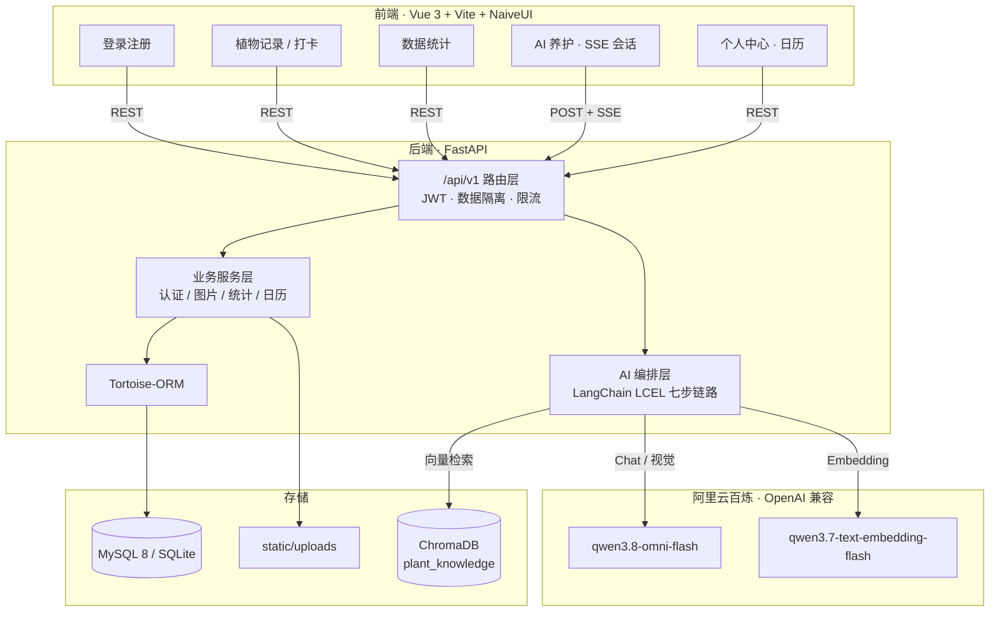
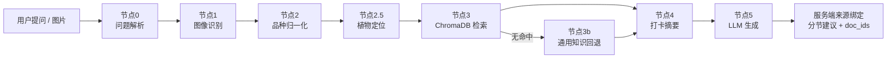

# 🌿 PlantPulse · 植株养护 RAG 智能助手

> 拍照识别 + 知识库检索 + 打卡数据融合，生成**有来源、可追溯、防幻觉**的个性化养护建议。

[](https://www.python.org/)
[](https://fastapi.tiangolo.com/)
[](https://vuejs.org/)
[](https://www.naiveui.com/)
[](https://python.langchain.com/)
[](https://www.trychroma.com/)
[](https://www.mysql.com/)
[](#-测试)

PlantPulse 是一个面向家庭园艺爱好者的智能养植 Web 应用。它把「植物档案 + 养护打卡 + 指标记录」沉淀为个人养护数据，再通过一条固定的 AI-RAG 工作流，把**图像识别结果、本地知识库文档、用户近期打卡**三者合并，交给大模型生成分节养护建议。

与常见「直接问大模型」的方案不同，本项目把**防幻觉**做进了工程链路：流式生成时模型完全接触不到文档 ID，来源由服务端按主题关键词绑定；没有命中知识库时强制标注「通用知识」。

---

## ✨ 核心特性

### 养护数据闭环
- **植物建档**：名称、品种、图片、位置、种植日期、备注。
- **快捷打卡**：浇水 / 施肥 / 修剪 / 换盆 / 病虫害防治 / 其他，支持一次最多 5 张图片与备注。
- **指标记录**：温度、空气湿度、光照、土壤湿度、pH 五维指标，同日重复录入自动覆盖。
- **数据统计**：长势健康分、浇水次数、施肥次数、平均光照四维度趋势（7 / 30 / 90 天）。
- **日历打卡**：月历视图、连续打卡天数、本月统计、养护偏好 Top3。

### AI 智能养护
- **双输入**：纯文本提问自动解析植物名；上传图片由多模态模型识别品种。
- **七步固定链路**：问题解析 → 图像识别 → 品种归一化 → 植物定位 → 知识检索 → 打卡摘要 → LLM 生成。
- **SSE 流式输出**：前置节点推送阶段进度，生成阶段逐字输出，首字节不再白屏等待 40 秒。
- **服务端来源绑定**：模型只输出「【浇水】…」正文，`doc_ids` 由服务端匹配本轮检索片段，从根上杜绝编造引用。
- **降级标注**：知识库无命中或 LLM 异常时输出通用养护知识，并标记 `is_fallback=true`。
- **会话式追问**：同一 `session_id` 共享多轮记忆，支持新建对话、打开历史、删除历史、停止生成、失败重试。

### 工程与安全
- 统一响应结构 `{"code", "msg", "data"}`，业务码与 HTTP 状态解耦。
- 单 JWT 鉴权（7 天）+ bcrypt 密码哈希；注册图形验证码落库、5 分钟一次性。
- 全链路 `user_id` 数据隔离，越权统一 403。
- AI 接口按用户限流（默认 5 次/分钟）；上传类型与大小双重校验。
- bcrypt、图片落盘、验证码渲染等同步操作统一卸载到线程池，避免阻塞事件循环。

---

## 🏗️ 技术架构



### 技术栈

| 层次 | 技术 | 说明 |
|---|---|---|
| 前端 | Vue 3.5 · Vite 5 · Pinia 2 · Vue Router 4 | 组合式 API，HTML5 history |
| UI / 图表 | NaiveUI 2.45 · ECharts 5.5 | NaiveUI 全量引入；ECharts 按需注册 |
| 请求 | Axios · fetch + ReadableStream | REST 用 Axios，SSE 用原生 fetch |
| 后端 | Python 3.13 · FastAPI · Uvicorn | 全异步路由 |
| ORM / DB | Tortoise-ORM 0.22 · MySQL 8 / SQLite | 生产 MySQL，测试 SQLite |
| 鉴权 | PyJWT · bcrypt · captcha + Pillow | 单 Token，cost 12，图形验证码 |
| AI 编排 | LangChain 0.3.27（LCEL） | 锁定 0.3 稳定线 |
| 向量检索 | ChromaDB 1.x | 本地持久化，cosine 距离 |
| 模型服务 | 百炼 OpenAI 兼容接口 | MaaS 主地址 / dashscope 备用可切换 |

---

## 📁 目录结构

```text
PlantPulse/
├── backend/
│   ├── app/
│   │   ├── main.py                  # 应用入口：Tortoise / CORS / 异常 / 静态挂载
│   │   ├── core/                    # 配置、统一响应、JWT、依赖注入、时区、迁移
│   │   ├── models/                  # 6 张表：user/captcha/plant/plant_record/plant_metric/ai_advice
│   │   ├── schemas/                 # Pydantic 请求 / 响应模型
│   │   ├── services/                # 验证码、图片存储、统计、日历
│   │   ├── api/v1/                  # auth/plants/metrics/stats/checkins/upload/user/ai
│   │   └── ai/                      # chain/prompts/retriever/vector_store/ingestion/memory
│   ├── sql/schema.sql               # MySQL 建表脚本
│   ├── scripts/                     # 知识库入库、链路冒烟、RAG 调参、静态校验
│   ├── tests/                       # 9 个测试文件 / 124 个用例
│   ├── requirements.txt
│   ├── requirements-ai.txt
│   └── .env.example
├── frontend/
│   ├── src/
│   │   ├── api/                     # request / ai / plants / checkins / metrics / stats / upload
│   │   ├── components/ai/           # AdviceCard / SessionList
│   │   ├── router/                  # 路由 + 登录守卫
│   │   ├── stores/auth.js
│   │   ├── views/                   # Login / Plants / PlantDetail / Stats / AICare / Profile
│   │   └── App.vue
│   └── vite.config.js               # /api 与 /static 代理
├── docs/
│   ├── PRD.md                       # 产品需求文档（实现对齐版）
│   └── knowledge_base/              # 知识库：60 个品种 + 8 篇通用
└── .venv/                           # 项目唯一虚拟环境（git 忽略）
```

---

## 🚀 快速开始

### 环境要求

| 依赖 | 版本 | 备注 |
|---|---|---|
| Python | 3.13 | 项目根统一 `.venv` |
| Node.js | 18+（实测 24） | 前端构建 |
| MySQL | 8.0+ | 也可切 SQLite 快速体验 |
| 百炼 API Key | — | LLM 与 Embedding 各一个，需开通对应模型 |

### 1. 安装后端依赖

```bat
# 项目根目录
python -m venv .venv

# Windows
.venv\Scripts\activate


pip install -r backend\requirements.txt
pip install -r backend\requirements-ai.txt
```

### 2. 配置环境变量

```bat
copy backend\.env.example backend\.env
```

`.env` **必须放在 `backend/` 下**（配置按工作目录读取），并按实际环境修改：

| 变量 | 说明 |
|---|---|
| `DATABASE_URL` | 默认 `mysql://<user>:<password>@127.0.0.1:3306/plantpulse?charset=utf8mb4`（模板值见 `.env.example`）；可改 `sqlite://./db.sqlite3` |
| `JWT_SECRET` | 生产必须替换为随机长字符串 |
| `ACCESS_TOKEN_EXPIRE_DAYS` | 登录有效期，默认 7 天 |
| `LLM_API_KEY` / `EMBEDDING_API_KEY` | 百炼密钥，**两份独立** |
| `LLM_BASE_URL` / `EMBEDDING_BASE_URL` | MaaS 专属地址；`AI_USE_FALLBACK_BASE_URL=true` 可切 dashscope |
| `LLM_MODEL` / `EMBEDDING_MODEL` | 默认 `qwen3.8-omni-flash` / `qwen3.7-text-embedding-flash` |
| `RAG_TOP_K` / `RAG_SCORE_THRESHOLD` | 检索条数与阈值，`.env.example` 预置实测调优值 `3 / 0.55` |
| `AI_TIMEOUT_SECONDS` | AI 链路超时，预置 `120`（MaaS 生成约 40~60s） |
| `AI_RATE_LIMIT_PER_MINUTE` | AI 接口限流，默认 5 次/分钟 |

> `.env` 已被 `.gitignore` 忽略，请勿提交真实密钥。

### 3. 初始化数据库

```bat
mysql -u root -p -e "CREATE DATABASE IF NOT EXISTS plantpulse DEFAULT CHARACTER SET utf8mb4 COLLATE utf8mb4_unicode_ci;"

# 可选：执行完整建表脚本（含字段注释与索引）
mysql -u root -p < backend\sql\schema.sql
```

开发环境（`ENV=development`）启动时 `Tortoise.generate_schemas()` 会自动建表，因此**只需先创建数据库**即可；`schema.sql` 用于生产或需要完整索引/注释的场景。

> 注意：`schema.sql` 末尾的索引调整语句在全新数据库上可能报「索引不存在」。可先注释末尾两行再执行，或直接依赖开发环境自动建表。

### 4. 知识库入库（AI 功能必需）

知识库文档位于 `docs/knowledge_base/`（60 篇品种 + 8 篇通用，入库后约 137 条切片）：

```bat
cd backend

# 全量重建（首次或知识库结构大改）
..\.venv\Scripts\python.exe -m scripts.ingest_knowledge --rebuild

# 日常增量（新增/修改文件自动覆盖旧向量）
..\.venv\Scripts\python.exe -m scripts.ingest_knowledge
```

向量库持久化在 `backend/chroma_db/`（git 忽略），重启不丢失。

### 5. 启动后端

```bat
cd backend
..\.venv\Scripts\python.exe -m uvicorn app.main:app --reload --port 8000
```

- API 文档：<http://localhost:8000/docs>
- 健康检查：<http://localhost:8000/api/v1/health>

### 6. 启动前端

```bat
cd frontend
copy .env.example .env.development
npm install
npm run dev
```

访问 <http://localhost:5173>。开发服务器会把 `/api` 与 `/static` 代理到 `localhost:8000`。

> 若 `npm install` 因 esbuild 平台二进制失败，先执行 `npm install --ignore-scripts`，再 `npm rebuild esbuild`。项目已在 `package.json` 中通过 `overrides` 锁定 `esbuild ^0.25.0`。

### 7. 一键自测

```bat
cd backend

# 124 个单元测试（独立临时 SQLite，不触碰开发库）
..\.venv\Scripts\python.exe -m pytest -v

# AI 链路冒烟（需真实网络与密钥）
..\.venv\Scripts\python.exe -m scripts.smoke_ai --query "绿萝叶子发黄怎么办" --species 绿萝

# RAG 检索调参
..\.venv\Scripts\python.exe -m scripts.tune_rag --query "绿萝叶子发黄" --species 绿萝
```

---

## 🤖 AI-RAG 工作流



**执行路径**

- 纯文本：`0 → 2 → 2.5 → 3/3b → 4 → 5`
- 纯图片：`1 → 2 → 2.5 → 3/3b → 4 → 5`
- 图片 + 文本：以图像识别为准

**流式事件协议**（`POST /api/v1/ai/care-advice/stream`）

```text
event: stage
data: {"node": 3, "label": "正在检索养护知识库"}

event: delta
data: {"text": "【浇水】表土干燥 2~3 厘米后浇透。"}

event: done
data: {"code": "200", "msg": "success", "data": { "...建议详情..." }}
```

- `: ping` 注释帧每 10s 心跳，防止反代空闲断连。
- 用户停止生成 = 取消上游请求，**不落库、不写记忆**。

**防幻觉设计**

| 策略 | 做法 |
|---|---|
| 引用绑定 | 流式链路模型不接触 `doc_id`，服务端按分节主题匹配检索片段，最多绑定 2 个来源 |
| 阈值过滤 | 低于 `RAG_SCORE_THRESHOLD` 的切片不进入上下文 |
| 置信度兜底 | 视觉置信度 < 0.6 走「未知品种」通用知识路径 |
| 结构校验 | `knowledge` 分节必须带 `doc_ids`，否则降为 `general` |
| 失败降级 | LLM 异常输出通用知识并标 `is_fallback=true`，而非直接 5xx |
| 可追溯 | `trace` 记录节点耗时、检索结果与提示词 hash |

---

## 🔌 API 速查

统一前缀 `/api/v1`，鉴权头 `Authorization: Bearer <token>`。

| 模块 | 主要接口 |
|---|---|
| 认证 | `GET /auth/captcha` · `POST /auth/register` · `POST /auth/login` · `GET/PUT /auth/profile` · `PUT /auth/avatar` · `PUT /auth/password` |
| 植物 | `GET /plants` · `POST /plants` |
| 指标与统计 | `POST/GET /plants/{id}/metrics` · `GET /plants/{id}/stats` |
| 打卡 | `POST/GET /checkins` · `GET /checkins/calendar` · `PUT/DELETE /checkins/{id}` · `GET /user/stats` |
| AI | `POST /ai/identify` · `POST /ai/care-advice` · `POST /ai/care-advice/stream` · `GET /ai/advices[/{id}]` · `POST /ai/advices/{id}/feedback` · `GET /ai/sessions[/{id}]` · `DELETE /ai/sessions/{id}[/history]` |
| 公共 | `POST /upload/image` · `GET /static/uploads/{file}` |

完整接口定义与业务规则见 [`docs/PRD.md`](docs/PRD.md) 第 9 章，或启动后端后访问 `/docs`。

---

## 🧪 测试

```bat
cd backend
..\.venv\Scripts\python.exe -m pytest -v
```

| 测试文件 | 用例 | 覆盖 |
|---|---|---|
| `test_health.py` | 1 | 健康检查与统一响应 |
| `test_auth.py` | 11 | 验证码、注册、登录、401 |
| `test_plants.py` | 7 | 植物建档与校验 |
| `test_checkins.py` | 29 | 打卡、多图、筛选、上传、越权 |
| `test_stats.py` | 16 | 指标录入/覆盖/越界、四维度统计 |
| `test_profile.py` | 26 | 资料、头像、改密、日历、撤销 |
| `test_ai.py` | 21 | AI 同步链路、建议、会话隔离 |
| `test_ai_stream.py` | 6 | SSE 事件序列与正文一致性 |
| `test_ai_question_parser.py` | 7 | 问题解析与品种匹配 |

前端当前未接入 ESLint / 单元测试，构建校验：

```bat
cd frontend
npm run build
```

---

## 📚 文档

- [产品需求文档（PRD）](docs/PRD.md)：页面、功能点、接口、数据模型、AI 链路、验收标准
- [知识库编写规范](docs/knowledge_base/README.md)：frontmatter 字段、五主题分节、入库与调参
- [后端说明](backend/README.md)
- [前端说明](frontend/README.md)

---

## ⚠️ 已知限制

- 植物仅支持新增与列表，**编辑 / 删除 / 图片更换未实现**；`/plants/:id` 为占位页。
- `plants.status` 尚未由规则引擎派生，固定为 `healthy`。
- AI 限流与会话记忆为**进程内状态**，多 worker 部署下不共享；生产建议接 Redis 或固定单 worker。
- 上传文件存本地磁盘且未做访问鉴权，生产建议迁移对象存储。
- 统一响应格式尚未覆盖未匹配路由（404/405）。
- 前端无自动化测试，质量门禁仅 `npm run build`。

---

## 📄 许可证

本项目当前未声明开源许可证。如需引用、二次开发或商用，请先联系仓库作者。

---

<p align="center">
  <sub>Built with FastAPI · Vue 3 · LangChain · ChromaDB</sub>
</p>